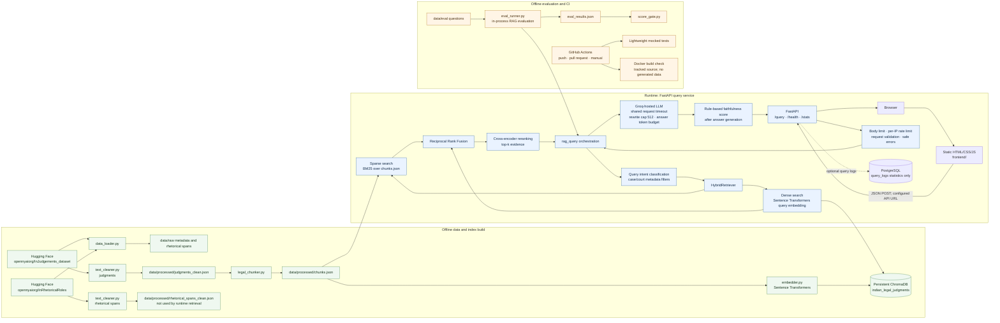
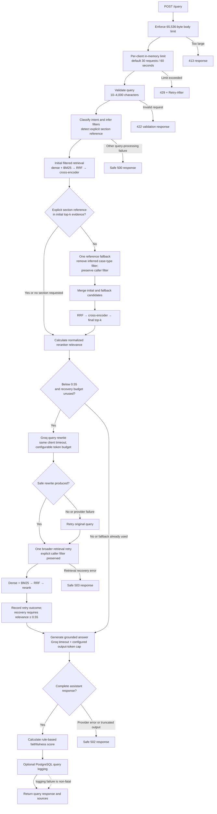
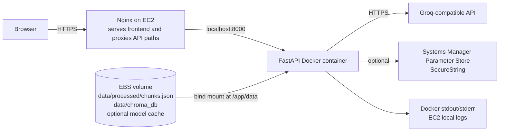

# Indian Legal RAG

A research prototype that retrieves Indian court judgment passages and generates source grounded answers. Phase 1 covers reproducible ingestion, hybrid retrieval, API behavior, evaluation scripts, and optional PostgreSQL query statistics.

## Architecture

The first diagram separates the live API path from local data/index preparation and from evaluation/CI. PostgreSQL stores optional request statistics only; it does not store judgments or vectors. Rhetorical-role spans are produced as an ingestion artifact but are not used by live retrieval. The second diagram shows the query's filtering and bounded recovery paths.

### System architecture



### Query lifecycle and recovery



The live service uses the existing local hybrid retriever and Groq-compatible API client. The browser frontend is a separate static process and sends no provider credentials. Evaluation calls the RAG pipeline directly against the configured local index; CI runs mocked/lightweight tests and builds the image, but does not run the full benchmark or create the local index.

## Technology stack

- **API:** FastAPI, Pydantic request/response models, and Uvicorn.
- **Retrieval:** Sentence Transformers query embeddings, persistent ChromaDB, BM25 (`rank-bm25`), RRF, and a Sentence Transformers cross-encoder reranker.
- **Generation:** Groq-compatible chat completions through the OpenAI Python client; model name and bounded answer/rewrite token budgets come from environment configuration.
- **Data preparation:** Hugging Face `datasets`, ingestion/cleaning/chunking scripts, and a local embedding/index build.
- **Frontend:** static HTML, CSS, and JavaScript with a configurable public API base URL; no frontend framework or build step.
- **Optional telemetry:** PostgreSQL for query statistics only; it does not store judgments, chunks, or vectors.


## Implemented behavior

- Ingestion downloads OpenNyAI judgment and rhetorical role datasets; preprocessing cleans judgments and chunking produces 1,000 character chunks with 200 character overlap.
- Chunking processes every cleaned judgment by default. Use `--limit N` for a local debug run.
- Embeddings use sentence-transformers and are stored in a local ChromaDB collection. Retrieval combines dense ChromaDB results and BM25 results with reciprocal rank fusion, followed by the existing cross encoder reranker.
- `POST /query` accepts `filter_case_type`; it is applied to dense and BM25 retrieval.
- `POST /query` is limited to 30 requests per client IP per 60 seconds by default. Configure `QUERY_RATE_LIMIT_REQUESTS` and `QUERY_RATE_LIMIT_WINDOW_SECONDS` in `.env`. The limit is held in process memory, so it resets on restart and is independent per worker/instance; it is suitable for this single-instance demo, not a distributed deployment.
- The answer generator and query rewrite use a Groq-hosted model through the OpenAI-compatible client. Set `GROQ_API_KEY` and `LLM_MODEL` in `.env`; configure `LLM_REQUEST_TIMEOUT_SECONDS`, `LLM_MAX_OUTPUT_TOKENS`, and `LLM_MAX_REWRITE_TOKENS` for the provider timeout and bounded answer/rewrite budgets. Data downloads can use `HF_TOKEN` when required by Hugging Face.
- PostgreSQL query logging is optional. Logging failures are warnings and do not fail a query. `/stats` requires a configured, reachable database with the documented `query_logs` table.

The project does not currently implement rhetorical role retrieval/classification, citation graph retrieval, NLI faithfulness, agents, or authentication. Evaluation relevance is the mean cross encoder reranker score normalized to 0–1, not a probability of correctness. Faithfulness is a narrow rule based check of whether extracted numbers and legal references appear in retrieved text; it does not establish semantic entailment or legal correctness. Answer overlap is token set F1 after stopword removal. None of these scores are legal quality guarantees.

## Requirements and setup

Use Python 3.11. On Windows, install the same requirements; uvloop is installed only on non Windows platforms.

```powershell
py -3.11 -m venv .venv
.venv\Scripts\Activate.ps1
python -m pip install --upgrade pip
python -m pip install -r requirements.txt
Copy-Item .env.example .env
# Set GROQ_API_KEY and LLM_MODEL in .env. HF_TOKEN is only needed if
# Hugging Face requires authentication for dataset/model downloads.
```

`GROQ_API_KEY` and `LLM_MODEL` are required for answer generation and query rewriting. `.env.example` contains placeholders and defaults for timeout, answer/rewrite token budgets, query rate limiting, diagnostics, and optional PostgreSQL. Never commit `.env`; do not place provider credentials in `frontend/config.js`. `HF_TOKEN` is only for data/model downloads when required.

## Build the local index

The full dataset is the default. These commands download and process the complete datasets and can take substantial time and disk space. Generated files under `data/` are intentionally excluded from git and Docker build context.

```powershell
python src/ingestion/data_loader.py
python src/ingestion/text_cleaner.py
python src/chunking/legal_chunker.py
python src/embeddings/embedder.py
```

For a quick chunking debug run, after preprocessing has created `data/processed/judgments_clean.json`, use: `python src/chunking/legal_chunker.py --limit 50`. Embedding has its own optional `max_chunks` Python argument; the normal script indexes all generated chunks.

## Run the API

```powershell
$env:PYTHONPATH = "."
python -m uvicorn src.api.main:app --reload --port 8000
```

The API loads the local ChromaDB collection and chunk JSON at startup, so build the index first. Open `http://localhost:8000/docs` to inspect the API.

## Frontend demo

The static frontend has no build step or framework. With the backend running and the local index available, start it in a second PowerShell terminal from the repository root:

```powershell
python -m http.server 5173 --bind 127.0.0.1 --directory frontend
```

Open `http://127.0.0.1:5173`. By default, the page sends requests to `http://127.0.0.1:8000`; change `LEGAL_RAG_API_BASE_URL` in `frontend/config.js` if the API uses another origin. The existing FastAPI CORS middleware allows this separate local origin, so no backend static-file or CORS changes are required. Keep provider keys in the backend environment; the browser config contains only the API URL.

## Evaluation and CI

The full evaluation remains `python src/evaluation/eval_runner.py` followed by `python src/evaluation/score_gate.py data/eval/eval_results.json`. It uses the existing evaluation dataset, local index, configured LLM generation, and current score gate thresholds (relevance 0.55, faithfulness 0.60, answer overlap 0.10). Metric averages include only eligible observations and include per-metric counts. Overall `pass` requires both all questions to return a non-empty answer and all quality thresholds to pass; `quality_thresholds_pass` and `execution_pass` report those checks separately. Per-question answer status distinguishes completed, empty, failed, and truncated responses. Truncated generations are excluded from answer-quality averages, while retrieval relevance is retained when available. Textual abstentions are treated as completed answers because the output has no explicit abstention marker. Self-heal rate is successful retrieval recoveries divided by questions that triggered a rewrite; per-question records and summary counts distinguish rewrite attempts/successes/failures, retry attempts/successes/failures, and successful/failed recoveries. A failed rewrite can still be followed by one retry using the original query. Evaluation latency excludes the one-second provider throttle. The benchmark is not run automatically in CI.

Push and pull request CI installs `requirements-ci.txt` and runs lightweight unit tests with synthetic retrieval results and mocked model services. It does not download judgment data, models, or run the full benchmark.

## Docker

Build the application image without generated data: `docker build -t indian-legal-rag .`. To serve queries, first build the local index as above, then mount the generated data directory and provide required environment variables when running the image. For example, in PowerShell:

```powershell
docker run --rm -p 8000:8000 -v "$(Resolve-Path data):/app/data" --env-file .env indian-legal-rag
```

The image build uses tracked source and pinned direct dependencies. Index files remain local artifacts and must be generated separately.

## AWS deployment plan (proposed; not deployed or validated)

The repository contains no AWS deployment configuration, infrastructure-as-code, Docker Compose file, or deploy workflow. The steps below are a practical single-instance plan based on the current local-file architecture; they have not been run against AWS.

### Recommended first deployment

Use one Linux **EC2** instance with Docker, host-level Nginx, and an attached **EBS gp3** volume:



This keeps the existing Chroma persistence and BM25 chunk file on a persistent block volume attached to one host. The API container remains disposable: replacing it must not replace `/app/data`. Do not point ChromaDB's SQLite persistence directory at an S3 bucket or assume a shared network filesystem is a safe replacement; neither configuration is used or validated by this project.

The Dockerfile copies `src/` only. It does not copy the frontend, `data/processed/chunks.json`, or `data/chroma_db`; `.dockerignore` also excludes all of `data/`. Serve the checked-out `frontend/` directory from Nginx on the host and bind-mount the prebuilt runtime data into the container. The API and frontend can share one HTTPS origin: set `window.LEGAL_RAG_API_BASE_URL` in the deployed `frontend/config.js` to that origin (for example, `https://your-host.example`). Configure Nginx to serve `/` from `frontend/` and proxy `/query`, `/health`, and `/stats` to `http://127.0.0.1:8000`. Keep port 8000 bound to loopback; expose only the web ports at the network edge.

### Why EC2 for this version

- **EC2 + EBS (recommended):** few AWS services and direct control over memory, disk, model cache, and Docker mounts. It fits the existing on-disk ChromaDB and full BM25 JSON load. The trade-off is that you patch and monitor the host, configure TLS/reverse proxy, and run a single point of failure. Pick instance memory and EBS capacity only after measuring the actual artifacts and testing startup; the repository does not provide a verified minimum. AWS's [EC2/Fargate comparison](https://aws.amazon.com/compare/ec2-and-fargate/) describes the host-management and per-task trade-offs.
- **ECS/Fargate (alternative, not configured):** reduces host administration, but requires ECS task/service configuration, image distribution, appropriate task sizing, and a deliberate persistent-volume design. Fargate's default task storage is ephemeral (configurable for supported Linux tasks); ECS also documents EBS and EFS options. This project has not tested ChromaDB or the full BM25 data path on those mounts, so Fargate is not the first deployment choice. See [Fargate task storage](https://docs.aws.amazon.com/AmazonECS/latest/developerguide/fargate-task-storage.html) and [ECS storage options](https://docs.aws.amazon.com/AmazonECS/latest/developerguide/using_data_volumes.html).

### Frontend hosting alternatives

Serving the frontend from Nginx on the same EC2 instance is the lowest-service-count option and avoids a second browser origin. If you prefer a managed static host, **Amplify Hosting** is a simpler HTTPS option for this plain HTML/CSS/JS frontend. **S3 plus CloudFront** is another standard static-hosting pattern, but it adds a distribution; an S3 website endpoint alone is HTTP-only, while CloudFront can provide HTTPS with a private S3 origin. Either separate-host option needs the deployed API URL in `frontend/config.js`, an HTTPS API origin, and a restricted production CORS allowlist in backend code. Current CORS allows every origin (`allow_origins=["*"]`), so the code does not currently provide an origin allowlist. See AWS's [S3 static website guidance](https://docs.aws.amazon.com/AmazonS3/latest/userguide/WebsiteHosting.html) and [secure CloudFront/S3 setup](https://docs.aws.amazon.com/AmazonCloudFront/latest/DeveloperGuide/getting-started-secure-static-website-cloudformation-template.html).

### AWS resources: needed, optional, and unnecessary initially

| Status | Resource | Purpose and project-specific note |
| --- | --- | --- |
| Needed for the recommendation | EC2, security group/VPC, EBS | Host Docker/Nginx; persist `chunks.json` and `chroma_db` outside the container. Keep the EBS volume when replacing or terminating compute. |
| Needed operationally | IAM instance profile | Least-privilege access if the instance reads a secret from Parameter Store or artifacts from S3. Do not put long-lived AWS access keys in the container. |
| Optional | Systems Manager Parameter Store `SecureString` | Inject `GROQ_API_KEY` at deployment/runtime without committing it. Secrets Manager is an alternative when rotation/audit features justify its per-secret and API charges. These integrations are deployment work, not implemented by the app. AWS documents the [Parameter Store/Secrets Manager trade-offs](https://docs.aws.amazon.com/systems-manager/latest/userguide/systems-manager-parameter-store.html). |
| Optional | Private S3 bucket | Staging or backup for large generated artifacts. Copy the active Chroma directory onto the attached volume before startup; S3 is not the configured runtime persistence path. Storage and transfer can cost money. |
| Optional | CloudWatch Logs agent/configuration | Centralize Docker/application logs and add alarms. The app writes Python logs to standard output; the repo does not configure log shipping. CloudWatch collection and retention can incur charges; see the [CloudWatch agent guide](https://docs.aws.amazon.com/AmazonCloudWatch/latest/monitoring/Install-CloudWatch-Agent.html). |
| Optional | Domain and DNS | Needed for a stable named HTTPS endpoint. Route 53 is not required if a domain is managed elsewhere. A public IPv4 address is billable; check [current AWS public IPv4 pricing](https://aws.amazon.com/vpc/pricing/). |
| Not needed for the first single-instance demo | RDS/PostgreSQL, ALB, ECR, ECS, CloudFront, Route 53 | PostgreSQL is optional and used only for query statistics; a single EC2 host can build the Docker image locally; there is no current load-balancing or multi-instance requirement. Add services only when a measured need justifies their operational and recurring cost. |

### Runtime configuration

The application reads configuration from environment variables. Put values in a root-readable, permission-restricted runtime env file or inject them from a secret store. Never bake secrets into a Docker image, Git, command history, or browser JavaScript.

| Variable | Required/use | Current behavior/default |
| --- | --- | --- |
| `GROQ_API_KEY` | Required for live generation and rewriting | Secret; configure only on the backend host/container. |
| `LLM_MODEL` | Required | Provider-supported model identifier; no Python fallback. |
| `LLM_REQUEST_TIMEOUT_SECONDS` | Optional | `60` seconds. |
| `LLM_MAX_OUTPUT_TOKENS` | Optional | `4096` maximum completion tokens for answer generation. |
| `LLM_MAX_REWRITE_TOKENS` | Optional | `2048` maximum completion tokens for query rewriting. |
| `QUERY_RATE_LIMIT_REQUESTS`, `QUERY_RATE_LIMIT_WINDOW_SECONDS` | Optional | `30` requests per `60` seconds by default, per process and client IP. This is not distributed and is not authentication. |
| `RAG_DIAGNOSTICS` | Optional | `false`; when enabled, bounded provenance and stage timing are logged server-side. |
| `DATABASE_URL` | Optional | PostgreSQL query logging and `/stats`; leave unset if no database is provisioned. Logging failures are non-fatal to a successful query. |
| `HF_TOKEN` | Ingestion only, if dataset access requires it | Not required for serving an already-built corpus/index. The runtime downloads embedding and reranker models from Hugging Face if they are not cached. |

These values match the current application and `.env.example`; keep `.env.example` placeholders only. The browser's `frontend/config.js` contains a public API URL, never a provider key.

### Deployment sequence (to validate on your account)

1. **Check capacity before creating resources.** On the machine holding the finished index, measure the size of `data/processed/chunks.json`, `data/chroma_db`, and the Hugging Face model cache. Measure peak memory during a normal `HybridRetriever` startup. The retriever loads the chunk JSON/BM25 corpus and two local models; do not guess an EC2 size or EBS volume size. Budget space for a safe data copy and future snapshots.
2. **Create a Linux EC2 instance and persistent EBS volume** in one region. Use an instance role with least-privilege permissions. Restrict SSH to your own IP or use Systems Manager Session Manager. The security group should expose only ports 80/443 publicly; do not expose the Uvicorn port. Attach the volume and mount it at a stable host path such as `/srv/indian-legal-rag`.
3. **Copy the already-built runtime data** onto that volume. Required paths inside the container are `/app/data/processed/chunks.json` and `/app/data/chroma_db`. Transfer them from the machine where the rebuild already exists (for example, `scp -r` over a restricted SSH connection). A private S3 bucket can be used as temporary staging instead. Do not run ingestion or embedding jobs as part of deployment. Ensure the data volume is not set to delete on instance termination and keep a separate backup/snapshot before upgrades; no backup job is configured by this repository.
4. **Check out the application and build the existing Dockerfile** on the instance (or transfer a locally built image if you have an image-transfer process):

   ```bash
   git clone <repository-url> /opt/indian-legal-rag
   cd /opt/indian-legal-rag
   docker build -t indian-legal-rag:release .
   ```

   The repository has no Compose file and the GitHub Actions Docker job only builds; it does not publish an image. ECR is therefore optional unless you later add image publishing/rollout automation.
5. **Configure secrets and runtime env.** Create a restricted env file outside the checkout (or retrieve `GROQ_API_KEY` from Parameter Store using the instance role). Set `LLM_MODEL` and any desired token/time/rate-limit values. Leave `DATABASE_URL` unset unless PostgreSQL logging is intentionally provisioned. No database is required for RAG queries.
6. **Start the container with persistent data mounts and loopback-only API binding.** After creating the host env file and mounting EBS, an indicative command is:

   ```bash
   sudo docker run -d --name indian-legal-rag \
     --restart unless-stopped \
     --env-file /etc/indian-legal-rag/runtime.env \
     -p 127.0.0.1:8000:8000 \
     -v /srv/indian-legal-rag/data:/app/data \
     -v /srv/indian-legal-rag/model-cache:/root/.cache/huggingface \
     indian-legal-rag:release
   ```

   The model-cache mount is optional but avoids downloading the embedding/reranker models again when replacing the container. Allow outbound HTTPS for model downloads and the configured Groq-compatible provider. Startup loads models, chunks, and the Chroma collection; wait for startup to finish before routing requests.
7. **Configure Nginx and TLS on the host.** Serve `/opt/indian-legal-rag/frontend` as static files and proxy `/query`, `/health`, and `/stats` to `127.0.0.1:8000` and forward `X-Forwarded-For`/`X-Forwarded-Proto` headers. Set the deployment copy of `frontend/config.js` to `window.LEGAL_RAG_API_BASE_URL = "https://<your-domain>";`. Use a domain and a TLS certificate for public HTTPS; do not advertise an HTTP-only public frontend as production-ready. No Nginx/TLS configuration is included or tested in the repository.
8. **Verify startup and a request.** From the instance, inspect `docker logs indian-legal-rag` and request `http://127.0.0.1:8000/health`. The endpoint reports `retriever_loaded`; it does not test Groq availability, database connectivity, or answer quality. After HTTPS proxy setup, check `https://<your-domain>/health`, then send one non-sensitive sample query through the frontend. The query may incur provider usage. Check that static assets load, source links open, and browser network requests target the production origin.

### Security and operating limits

The current API has no authentication and CORS is `*`. The in-memory rate limiter is per worker/process and is not a perimeter control. Before exposing a portfolio demo to unrestricted traffic, restrict ingress, add an origin allowlist in backend code, and decide how to control non-browser/API callers; those changes are outside this README-only update. Keep Uvicorn private behind Nginx, use TLS, patch the host, restrict SSH, and do not expose environment values in logs. `/health` is a lightweight process/retriever status endpoint, not a full dependency health check. The repository has no Docker health check, CloudWatch agent setup, alarm, backup automation, or deployment workflow.

### Cost notes

Expect charges for a running EC2 instance, allocated EBS storage and snapshots, public IPv4, outbound data, and any domain/DNS or optional S3, CloudWatch, Parameter Store/Secrets Manager, or CloudFront usage. A large memory-capable instance and durable volume may be the main costs for this workload. Stop or terminate compute you no longer use and review attached volumes, snapshots, IPs, logs, and buckets separately; stopping EC2 does not mean every attached resource is free. Prices depend on region, instance/storage selection, traffic, and retention. Use the [AWS Pricing Calculator](https://calculator.aws/) before provisioning rather than relying on a fixed estimate.

## Optional PostgreSQL statistics

Set `DATABASE_URL` to enable query logging. Create the table before using `/stats`:

```sql
CREATE TABLE query_logs (
    id SERIAL PRIMARY KEY,
    query TEXT,
    answer_preview TEXT,
    relevance_score FLOAT,
    faithfulness_score FLOAT,
    latency_ms FLOAT,
    cost_usd FLOAT,
    self_healed BOOLEAN,
    detected_intent TEXT,
    created_at TIMESTAMP
);
```

## Tests

```powershell
python -m pip install -r requirements-ci.txt
python -m unittest tests.test_phase1 -v
python -m unittest tests.test_self_healing_telemetry -v
python -m unittest tests.test_evaluation_audit tests.test_text_cleaner_encoding -v
```

## Limitations

This project is for legal research demonstration, not legal advice. The in-memory rate limit is not authentication or a distributed abuse-control mechanism. The BM25 corpus is loaded from the local chunk file at startup, and the local vector index and model downloads are not included in the repository.
